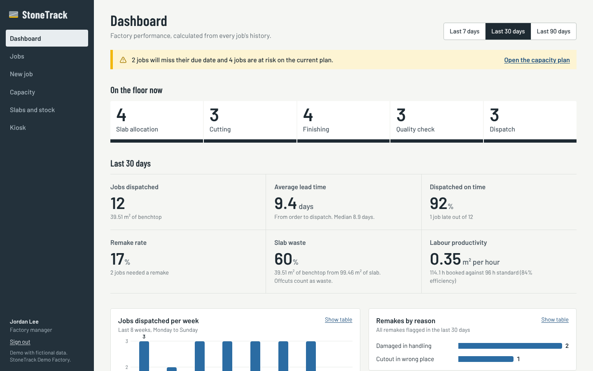
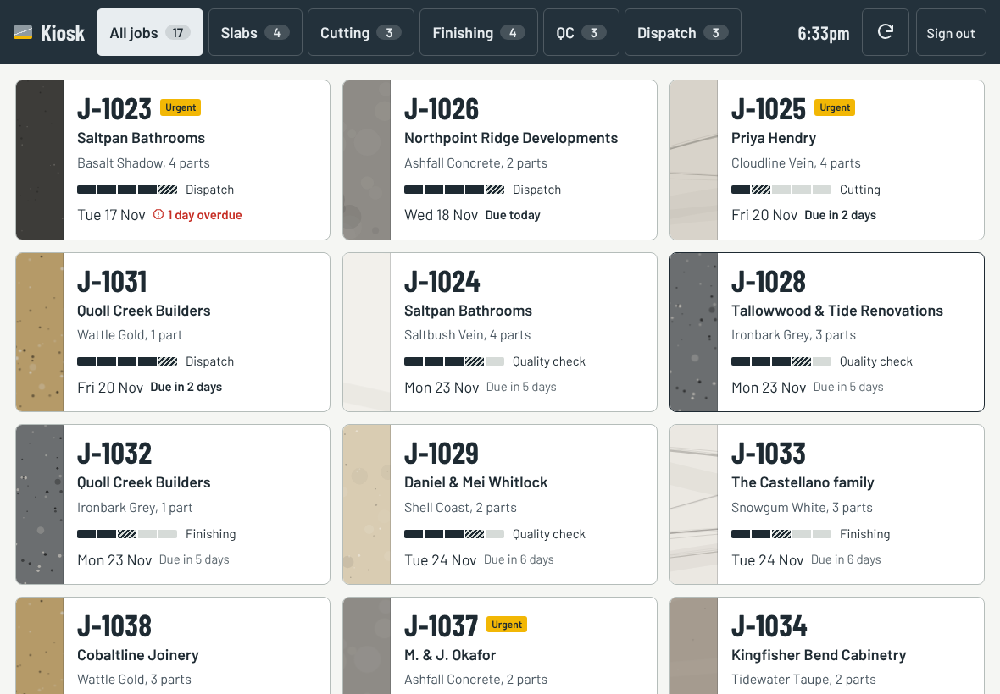
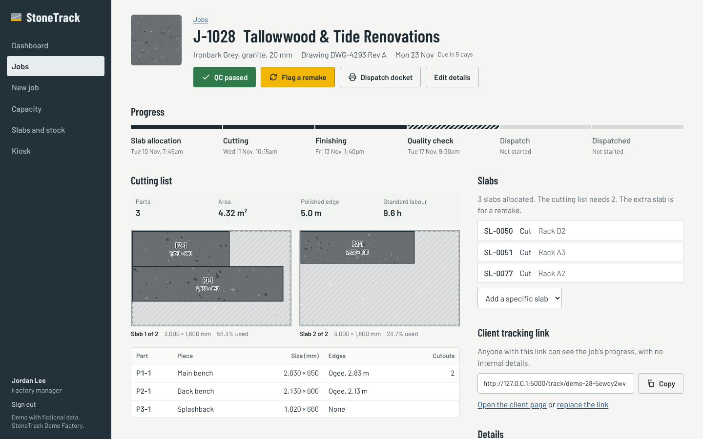
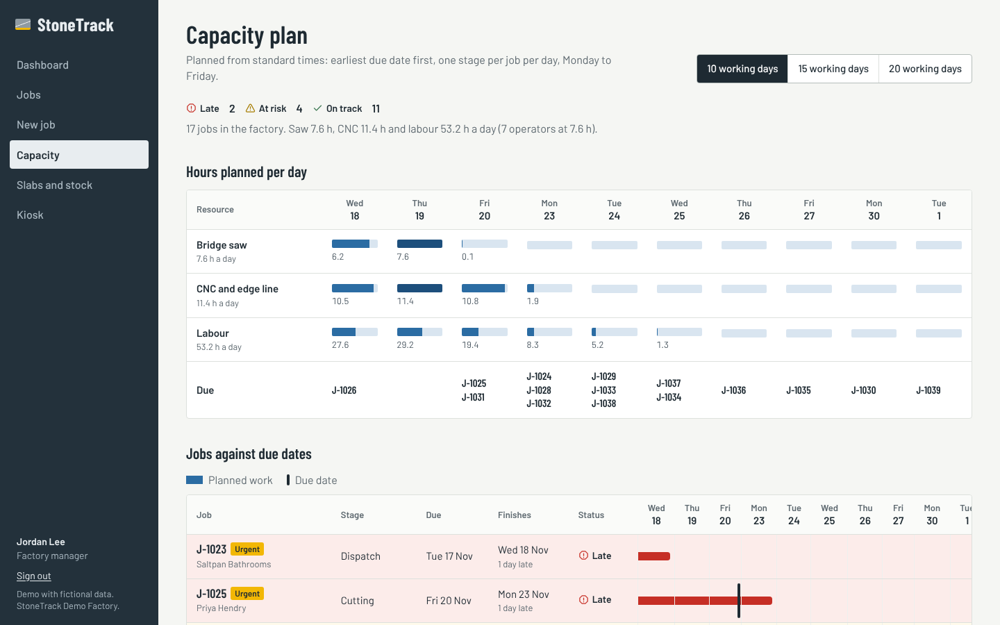

# StoneTrack

An operations platform for a (fictional) stone benchtop fabrication factory: job intake with a generated cutting list, shop-floor tracking from a tablet kiosk, slab stock, capacity planning, KPIs, dispatch dockets, a client tracking link and an order webhook.

Built as a portfolio demo with React + Vite, Node.js + Express and PostgreSQL, all in TypeScript, set up to run and publish on Replit. A staging copy also runs on Cloudflare Workers (see [Staging site on Cloudflare](#staging-site-on-cloudflare)).

> Every business, person, address, phone number and order in this project is invented. Phone numbers use the 03 5550 range reserved for fiction; emails use `.example` domains.

| Dashboard | Kiosk (tablet) |
| --- | --- |
|  |  |
| **Job detail with the cutting layout** | **Capacity plan** |
|  |  |

## What it does

1. **Job intake.** A form for client, due date, stone, pieces and drawing reference. While you type, it builds the cutting list: each part, polished edges, cutouts, a to-scale layout of the parts on slabs, slab yield and standard machine and labour hours.
2. **Job tracking.** Every job moves through Slab allocation, Cutting, Finishing, Quality check and Dispatch. Each change is a timestamped row in the job's history, with who did it and the labour hours booked.
3. **Factory kiosk.** A big-button tablet screen. A worker taps a job (tiles show the stone's colour, so they match the slab on the rack), then taps to complete the stage or flags a remake with a reason. Two kiosks tapping the same job at once can't skip a stage.
4. **Slabs and stock.** Every slab is tracked as available, allocated to a job or cut. Stock levels per stone with reorder warnings. Completing slab allocation picks slabs automatically, oldest first.
5. **Capacity planning.** Saw, CNC and labour hours scheduled day by day against capacity, earliest due date first, with late and at-risk jobs highlighted.
6. **KPI dashboard.** Throughput, average lead time, on-time rate, remake rate (and remakes by reason), slab waste and labour productivity, all calculated from job history.
7. **Dispatch docket.** A printable A4 docket per job with a QR code to the client's tracking page.
8. **Client portal.** A read-only progress page per job, opened from a share link. No sign-in, no internal details, and the link can be replaced.
9. **Roles.** Admin, factory manager and kiosk, with seeded demo users.
10. **Order webhook.** Another system can POST a new order as JSON. Requests are signed with HMAC-SHA256, and retries are safe (the same order twice gives the same job). There's a documented example call and a "Send a test order" button.

## Demo accounts

| Role | Username | Password | Sees |
| --- | --- | --- | --- |
| Admin | `admin` | `admin123` | Everything, plus users, integrations, machine hours and "reset demo data" |
| Factory manager | `manager` | `manager123` | Dashboard, jobs, intake, slabs, capacity, kiosk |
| Kiosk | `kiosk` | `kiosk123` | The kiosk only |

The login page lists these while `DEMO_MODE` is on (the default). Turn it off for anything real.

## Run it on Replit

### 1. Import the repository

1. Push this repository to GitHub (see the steps at the end of this file if you're starting from a zip).
2. Open **replit.com/import**, choose **GitHub**, connect your GitHub account if asked, pick the `stonetrack` repository and select **Import**.
3. If Replit offers to set the app up with Agent, you don't need to: the `.replit` file already configures the Run button and publishing.

### 2. Check the database

New Replit apps come with a PostgreSQL development database, and Replit connects it for you through the `DATABASE_URL` environment variable.

1. Open **Tools**, then **Database** (under Replit Cloud). You should see the development database. If it asks you to create one, create it.
2. In the **Shell**, check the app can see it:
   ```bash
   node -e "console.log(process.env.DATABASE_URL ? 'DATABASE_URL is set' : 'DATABASE_URL is missing')"
   ```

### 3. Install, migrate and seed

In the **Shell**:

```bash
npm install
npm run db:migrate   # creates the tables
npm run db:seed      # loads ~40 demo jobs (replaces all data)
```

(`npm run db:setup` does both database steps in one go.)

### 4. Run it

Press **Run**. This runs `npm install` and then `npm run dev`, which starts:

- the API (Express) on port 3001, and
- the React app (Vite) on port 5000, which forwards every `/api` request to the API.

The preview shows port 5000. Sign in with one of the demo accounts.

### 5. Run the tests

```bash
npm test
```

The tests use your development database but a separate schema called `stonetrack_test`, so they never touch your demo data. They create it at the start and drop it at the end.

### 6. Publish (deploy)

1. Create a secret for signing webhooks. In the Shell:
   ```bash
   node -e "console.log(require('crypto').randomBytes(32).toString('hex'))"
   ```
2. Open **Publish**. Under **Adjust settings**, keep the deployment type as **Autoscale** and add a production secret named `WEBHOOK_SECRET` with that value. The server won't start in production without it.
3. Select **Publish**. Replit runs the build command (`npm ci && npm run build`) and then `npm run start`.
4. Replit gives the published app its own production database. On start, the server applies any pending migrations, and if the database has no users yet it loads the demo data (because `DEMO_MODE` is on by default). Nothing else to run.
5. Open the published URL and sign in. `https://<your-app>.replit.app/api/health` should answer `{"ok":true,"database":"up","environment":"production"}`.

If Replit asks you to upgrade, publishing needs a plan that includes deployments.

## Run it on your own computer

You need Node.js 20 or newer and PostgreSQL 14 or newer.

```bash
cp .env.example .env            # then set DATABASE_URL
npm install
npm run db:setup
npm run dev                     # open http://localhost:5000
```

To try the production build locally:

```bash
npm run build
DATABASE_SSL=disable WEBHOOK_SECRET=any-long-local-secret-value PORT=5050 npm start
```

(`DATABASE_SSL=disable` because a local PostgreSQL usually has no SSL, while production defaults to SSL.)

## Staging site on Cloudflare

Besides Replit, the same app runs as a Cloudflare Worker. That gives a public staging link that redeploys itself on every push to `main`.

```
Browser ──► Cloudflare
              ├─ the React build (dist/client), served directly
              └─ /api/* ──► Worker (cloudflare/worker.ts) running the same Express app
                              └─► Hyperdrive (connection pool) ──► PostgreSQL on Neon
```

What's different from Replit, in short ([WALKTHROUGH.md](WALKTHROUGH.md), section 11, has the detail):

- Cloudflare serves the React files itself; only `/api/*` runs the Worker.
- Each request gets its own small database pool, and Hyperdrive keeps the real connections to Neon open.
- There's no start-up step: the first request each Worker instance handles applies migrations and seeds an empty database.
- A nightly cron job (16:00 UTC, 3am Melbourne summer time) restores the demo data, so the dates stay current.

### One-time setup

You need a Cloudflare account on the **Workers Paid** plan ($5 USD a month) and a free Neon account. The free Workers plan allows 10 ms of CPU per request; checking a password takes about 40 ms and building the demo data about 250 ms.

1. **Database.** On neon.com, create a project called `stonetrack` in the Sydney region. Select **Connect**, turn **Connection pooling** off (Hyperdrive does the pooling) and copy the connection string.
2. **Hyperdrive.** In the Cloudflare dashboard, open **Hyperdrive** and create a configuration called `stonetrack-db` with that connection string. Then turn its **caching off**. Otherwise Hyperdrive answers repeated reads from a cache for up to a minute, and a job moved on the kiosk could still show its old stage. Put the configuration's ID in `wrangler.jsonc` (`hyperdrive[0].id`) and push.
3. **Deploy from GitHub.** In **Workers & Pages**, select **Create application**, then **Import a repository**, and choose this repository. Keep the name `stonetrack` (it must match `name` in `wrangler.jsonc`). Set **Build command** to `npm run build:cf` and leave the deploy command as `npx wrangler deploy`. Select **Deploy**.
4. Open `https://stonetrack.<your-subdomain>.workers.dev/api/health`. It should answer `{"ok":true,"database":"up","environment":"production"}`. The very first request takes a few seconds while it creates the tables and loads the demo data.

After that, every push to `main` builds and deploys automatically. The Worker's logs are in the Cloudflare dashboard, or run `npx wrangler tail`.

**The webhook secret on staging** is in `wrangler.jsonc` on purpose. Staging is a public demo whose admin password is in this README, so the secret protects nothing extra, and having it public lets anyone send the example order to staging:

```bash
STONETRACK_URL=https://stonetrack.<your-subdomain>.workers.dev WEBHOOK_SECRET=stonetrack-staging-public-demo-secret npm run webhook:example
```

For a real deployment, delete it from `wrangler.jsonc` and store it as a secret with `npx wrangler secret put WEBHOOK_SECRET`.

### Run the Worker on your computer

`npm run cf:dev` builds the React app and runs the Worker in Cloudflare's runtime at http://localhost:8787. It uses the database in `localConnectionString` in `wrangler.jsonc`; change that to match your PostgreSQL, or set `CLOUDFLARE_HYPERDRIVE_LOCAL_CONNECTION_STRING_HYPERDRIVE`. To run the nightly reset by hand: `curl http://localhost:8787/cdn-cgi/local/scheduled`.

## Scripts

| Script | What it does |
| --- | --- |
| `npm run dev` | API (3001) and Vite (5000) together, both reloading on change |
| `npm run build` | Builds the React app to `dist/client` and bundles the server to `dist/server` |
| `npm start` | Runs the production server: one port, serves the API and the built app |
| `npm run db:migrate` | Applies pending SQL migrations |
| `npm run db:seed` | Replaces all data with the demo data (refuses in production without `--force`) |
| `npm run db:setup` | Both of the above |
| `npm test` | API and unit tests (Vitest + Supertest) against a real database |
| `npm run typecheck` | TypeScript checks for the server, the browser code and the Cloudflare Worker |
| `npm run webhook:example` | Sends a signed example order to the webhook |
| `npm run build:cf` | Builds the React app for Cloudflare (adds the security headers file) |
| `npm run cf:dev` | Runs the Cloudflare Worker locally at http://localhost:8787 |
| `npm run cf:deploy` | Builds and deploys to Cloudflare from your computer (run `npx wrangler login` first) |

## Configuration

Settings come from environment variables (on Replit: **Secrets**; locally: `.env`). There are separate development, test and production profiles in `server/config.ts`.

| Variable | Development default | Production default | Notes |
| --- | --- | --- | --- |
| `DATABASE_URL` | set by Replit | set by Replit | Required |
| `WEBHOOK_SECRET` | `dev-webhook-secret` | none: **required** | At least 16 characters |
| `DEMO_MODE` | `true` | `true` | Shows demo logins, seeds an empty database, allows "reset demo data" |
| `PORT` | | `5000` | Production port |
| `API_PORT` | `3001` | | Development API port (Vite proxies to it) |
| `DATABASE_SSL` | `disable` | `require` | `disable`, `require` (encrypted, certificate not checked, as Replit documents) or `verify` |
| `FACTORY_TIMEZONE` | `Australia/Melbourne` | `Australia/Melbourne` | Used for "today", due dates and KPI weeks |
| `LOG_LEVEL` | `debug` | `info` | Development logs are readable lines; production logs are JSON |
| `DEPLOY_TARGET` | `node` | `node` | `cloudflare` on the staging Worker (set in `wrangler.jsonc`): Cloudflare serves the React build, and rate limits read Cloudflare's visitor-address header |

## The order webhook

`POST /api/webhooks/orders` with a JSON order ([example](docs/example-order.json)) and two headers:

- `X-StoneTrack-Timestamp`: the current Unix time in seconds
- `X-StoneTrack-Signature`: `sha256=` followed by the hex HMAC-SHA256 of `<timestamp>.<raw body>`, using `WEBHOOK_SECRET`

Responses: `201` job created, `200` already received (same `externalRef`), `401` bad or old signature, `422` invalid order (with the reasons), `429` too many calls. Every call is logged on the **Integrations** page.

The easiest way to try it:

```bash
npm run webhook:example                                    # against http://localhost:5000
WEBHOOK_SECRET=<your production secret> npm run webhook:example -- --url https://<your-app>.replit.app
npm run webhook:example -- --ref QP-30001                  # run twice: the second answer is 200, duplicate: true
```

The same call with `curl` and `openssl`:

```bash
BODY=$(cat docs/example-order.json)   # change externalRef and dueDate (a future date) first
TS=$(date +%s)
SIG=$(printf '%s.%s' "$TS" "$BODY" | openssl dgst -sha256 -hmac "$WEBHOOK_SECRET" | sed 's/^.* //')
curl -X POST "http://localhost:5000/api/webhooks/orders" \
  -H "Content-Type: application/json" \
  -H "X-StoneTrack-Timestamp: $TS" \
  -H "X-StoneTrack-Signature: sha256=$SIG" \
  --data "$BODY"
```

## API

All responses are JSON. Errors always look like `{ "error": { "code", "message", "details"?, "requestId" } }`. Send `Authorization: Bearer <token>` after signing in.

| Method and path | Who | What |
| --- | --- | --- |
| `POST /api/auth/login`, `POST /api/auth/logout`, `GET /api/auth/me` | anyone / signed in | Sessions |
| `GET /api/meta`, `GET /api/health` | anyone | App settings, health check |
| `GET /api/jobs`, `POST /api/jobs` | admin, manager | List (filters: `status`, `stage`, `q`, `due`) and intake |
| `GET /api/jobs/:id`, `PATCH /api/jobs/:id` | admin, manager | Full job with cutting list and history; edit due date, priority, notes, address |
| `POST /api/jobs/:id/advance` | all roles | Complete the current stage (`expectedStage` required) |
| `POST /api/jobs/:id/remake` | all roles | Flag a remake with a reason |
| `POST /api/jobs/:id/allocate` | admin, manager | Allocate slabs (automatically, or specific `slabIds`) |
| `POST /api/jobs/:id/share-token` | admin, manager | Replace the client link |
| `GET /api/kiosk/jobs`, `GET /api/operators` | all roles | Kiosk data |
| `GET /api/slabs`, `GET /api/slabs/stock`, `POST /api/slabs`, `POST /api/slabs/:id/release` | admin, manager | Slab stock |
| `GET /api/capacity?days=10`, `GET /api/kpis?days=30` | admin, manager | Planning and KPIs |
| `GET /api/materials`, `GET /api/clients`, `GET /api/machines` | signed in / admin, manager | Reference data |
| `PATCH /api/machines/:id` | admin | Machine hours per day |
| `GET /api/public/jobs/:token` | anyone with the link | Client portal |
| `POST /api/webhooks/orders` | signed requests | Order webhook |
| `GET /api/webhooks/events`, `GET /api/webhooks/example`, `POST /api/webhooks/test` | admin | Webhook log and test |
| `GET /api/users`, `POST /api/users`, `PATCH /api/users/:id` | admin | Users |
| `POST /api/admin/reset-demo` | admin, demo mode | Restore the demo data |

## Project layout

```
client/      React app (pages, components, styles)
server/      Express API (routes, services, auth, database)
shared/      Code both sides use: stages, validation rules, the cutting list, types
tests/       API and unit tests
docs/        Example webhook order and screenshots
scripts/     The webhook example sender
cloudflare/  The staging Worker: entry point, bundled migrations, static-file headers
```

[WALKTHROUGH.md](WALKTHROUGH.md) explains the architecture, the data model and every main file.

## Troubleshooting

| Symptom | Fix |
| --- | --- |
| Server log says `DATABASE_URL is not set` | Open Tools, then Database, and make sure the app has a database |
| Server log says migrations are pending, or pages show errors about missing tables | `npm run db:setup` |
| Preview says "Blocked request. This host is not allowed" | Your Replit domain isn't in `server.allowedHosts` in `vite.config.ts`; add it |
| "The server does not support SSL connections" | Set `DATABASE_SSL=disable` (local databases) |
| Published app won't start: `WEBHOOK_SECRET must be set` | Add the secret under Publishing, Adjust settings |
| Tests say "Refusing to run tests" | The database ignored the `search_path` option (some connection poolers do). Point `TEST_DATABASE_URL` at a database just for tests |
| Kiosk says "Not enough stock" | Receive slabs for that stone on the Slabs page, then try again |
| Staging API answers `DATABASE_UNAVAILABLE` | Hyperdrive can't reach Neon. Check the Hyperdrive configuration's connection string (pooling off), then the Worker's logs |
| Staging shows "Worker exceeded resource limits" (error 1102) | The account is on the free Workers plan (10 ms of CPU per request). Switch to Workers Paid |
| Workers Builds fails: "The name in your Wrangler configuration file … must match" | Name the Worker `stonetrack`, or change `name` in `wrangler.jsonc` |
| Staging shows an old value right after a change | Hyperdrive caching is on. Turn it off in the Hyperdrive configuration |

## Pushing this repository to GitHub from a zip

```bash
unzip stonetrack.zip && cd stonetrack
# optional: make every commit yours (keeps the messages)
git config user.name "Your Name"
git config user.email "you@example.com"
GIT_EDITOR=true git rebase -r --root --exec "git commit --amend --no-edit --reset-author"
# create an empty repository called stonetrack on github.com first (no README, licence or .gitignore)
git remote add origin https://github.com/<your-username>/stonetrack.git
git push -u origin main
```
